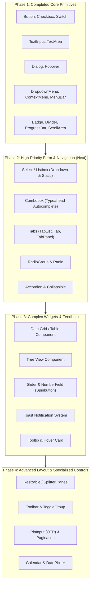

# Sveltui Component Checklist & Specification Matrix

Comprehensive checklist and specification matrix tracking **Sveltui** component coverage against:
- **W3C WAI-ARIA Authoring Practices Guide (APG)** design patterns
- **Bits-UI** (headless Svelte component primitives)
- **Base UI** (headless unstyled component primitives)

---

## 1. Overview & Current Coverage Summary

Sveltui follows a declarative, reactive architecture built on top of `crossterm`, combining Svelte-like ergonomics (`view! { ... }`, signals, snippets) with an opt-in DOM-like keyboard and focus interaction model.

| Metric | Count | Details |
|---|:---:|---|
| **Total Component Patterns Tracked** | **42** | Covering standard ARIA APG, Bits-UI, and Base UI component suites |
| **Implemented (Ready for Use)** | **14** | Production-ready in [`sveltui-components`](./crates/sveltui-components/src/lib.rs) and [`sveltui`](./crates/sveltui/src/lib.rs) core |
| **Partial / Core Primitives Ready** | **5** | Selection models and layout primitives available in core for widget composition |
| **Planned / Future Roadmap** | **23** | Scheduled for subsequent releases |

### Interaction & Theming Foundations
- **Focus & Keyboard Navigation**: Managed via [`FocusId`](./crates/sveltui/src/element/focus.rs), [`use_focus`](./crates/sveltui/src/element/focus.rs), explicit `tab_stop=true`, and [`FocusGroup`](./crates/sveltui/src/element/interaction.rs) roving tabindex.
- **Overlay & Layer System**: Managed via [`DismissLayer`](./crates/sveltui/src/element/interaction.rs), modal focus containment/trapping, opener restoration, backdrop hit testing, and outside-click dismiss chains.
- **Conservative Base-UI Aesthetic**: Monochromatic palette (`Color::White`, `Color::DarkGrey`), border styles (`BorderStyle::Single` unfocused, `BorderStyle::Double` focused/active), zero noisy default backgrounds, and full layout composability (`Padding`, `Size`, `FlexDirection`).

---

## 2. Currently Available Components in Sveltui

### Built-in UI Components (`crates/sveltui-components`)
1. [`Button`](./crates/sveltui-components/src/button.rs) — Interactive action button with keyboard press activation and focus states.
2. [`Checkbox`](./crates/sveltui-components/src/checkbox.rs) — Two-state boolean checkbox toggle with signal binding support.
3. [`Switch`](./crates/sveltui-components/src/switch.rs) — Semantic toggle switch with keyboard activation.
4. [`Badge`](./crates/sveltui-components/src/badge.rs) — Compact status indicator / tag with border and color options.
5. [`Divider`](./crates/sveltui-components/src/divider.rs) — Horizontal or vertical separator with optional embedded label.
6. [`Dialog`](./crates/sveltui-components/src/dialog.rs) — Modal dialog overlay with backdrop, focus trapping, and Escape key dismissal.
7. [`Popover`](./crates/sveltui-components/src/popover.rs) — Floating non-modal card anchored to a trigger with placement options.
8. [`ProgressBar`](./crates/sveltui-components/src/progress_bar.rs) — Visual progress indicator with custom fill/empty characters.
9. [`TextInput`](./crates/sveltui-components/src/text_input.rs) — Single-line editable text input with cursor positioning and submission handlers.
10. [`TextArea`](./crates/sveltui-components/src/text_area.rs) — Multi-line text buffer with 2D navigation, scrollbars, and editing.
11. [`DropdownMenu`](./crates/sveltui-components/src/menu.rs) — Composable menu (`Root`, `Trigger`, `Content`, `Item`, `Group`, `Sub`, `Separator`).
12. [`ContextMenu`](./crates/sveltui-components/src/menu.rs) — Right-click / pointer-positioned contextual popup menu.
13. [`MenuBar`](./crates/sveltui-components/src/menu.rs) — Horizontal desktop application menu bar with single Tab stop and arrow coordination.

### Core Framework Layout & Element Primitives (`crates/sveltui`)
14. [`FlexBox`](./crates/sveltui/src/element/flex.rs) — Flexbox layout container supporting borders, padding, gaps, scrollbars, hit testing, and focus groups.
15. [`Paragraph`](./crates/sveltui/src/element/text.rs) — Word-wrapped formatted text block with scrolling.
16. [`TextSpan`](./crates/sveltui/src/element/text.rs) / [`TextElement`](./crates/sveltui/src/element/text.rs) — Text runs with `fg`, `bg`, `bold`, `dim`, `italic`, `underline`.
17. [`Overlay`](./crates/sveltui/src/element/boundary.rs) — Root floating layer primitive with modal/non-modal policies and backdrop rendering.
18. [`ErrorBoundary`](./crates/sveltui/src/element/boundary.rs) — Declarative panic catcher with fallback snippets.
19. [`ContextProvider`](./crates/sveltui/src/element/provider.rs) — Scoped context dependency injection.
20. [`Collection` / Selection Primitives](./crates/sveltui/src/element/collection.rs) — Headless selection models (`Selection`, `GridSelection`, `TreeSelection`, `Typeahead`).

---

## 3. Master Checklist & Comparison Matrix

The table below catalogs components across **WCAG ARIA**, **Bits-UI**, and **Base UI**, specifying implementation status in Sveltui, interaction contracts, and theming capabilities.

> **Status Legend**:
> - `[x]` **Implemented**: Fully implemented with accessibility semantics, keyboard navigation, and customizable styling.
> - `[-]` **Partial / Core Ready**: Low-level engine primitives exist; high-level component shell in progress.
> - `[ ]` **Planned**: Specified on the roadmap for upcoming releases.

| Status | Component / Pattern | Category | Reference Standard | Keyboard Interaction | Mouse / Pointer Interaction | Theming & Customisation | Sveltui Source / Target |
|:---:|---|---|---|---|---|---|---|
| `[x]` | **Button** | Form / Action | WCAG APG / Bits-UI / Base UI | <kbd>Tab</kbd> focus; <kbd>Enter</kbd> / <kbd>Space</kbd> activates `on_click` (`Activation::Press`) | Click triggers action; hover updates focus state | `border` (`BorderStyle`), `border_color`, `padding`, `width`, `height`, `label`, `children` snippet, bold on active | [`Button`](./crates/sveltui-components/src/button.rs) |
| `[x]` | **Checkbox** | Form / Input | WCAG APG / Bits-UI / Base UI | <kbd>Tab</kbd> focus; <kbd>Space</kbd> toggles checked state (`Activation::Press`) | Click on box or label toggles checked state | `checked` binding (`ReadSignal` / `State`), `set_checked`, `label`, `width`, `height`, custom bracket indicators `[X]` / `[ ]` | [`Checkbox`](./crates/sveltui-components/src/checkbox.rs) |
| `[x]` | **Switch** | Form / Input | WCAG APG / Bits-UI / Base UI | <kbd>Tab</kbd> focus; <kbd>Space</kbd> / <kbd>Enter</kbd> toggles active state | Click toggles active state | `checked` / `set_checked`, `label`, custom slider track representation (`[ o]` vs `[o ]`), disabled styles | [`Switch`](./crates/sveltui-components/src/switch.rs) |
| `[x]` | **Text Input** | Form / Input | Bits-UI / Base UI / APG Textbox | <kbd>Tab</kbd> focus; alphanumeric typing; <kbd>←</kbd>/<kbd>→</kbd> cursor; <kbd>Home</kbd>/<kbd>End</kbd>; <kbd>Backspace</kbd>/<kbd>Del</kbd>; <kbd>Enter</kbd> submits | Click to focus and position cursor | `value`, `placeholder`, `title`, `border`, `border_color`, `width`, `cursor` styling, disabled state | [`TextInput`](./crates/sveltui-components/src/text_input.rs) |
| `[x]` | **Text Area** | Form / Input | Bits-UI / Base UI / APG Textbox | <kbd>Tab</kbd> focus; 2D arrow navigation (<kbd>↑</kbd><kbd>↓</kbd><kbd>←</kbd><kbd>→</kbd>); <kbd>Enter</kbd> inserts newline; word jumps; viewport tracking | Click positions 2D cursor; mouse wheel scrolls buffer viewport | `value` / `buffer`, `width`, `height`, `border`, `border_color`, scrollbars (`ScrollbarStyle`, `ScrollbarChars`), line wrap | [`TextArea`](./crates/sveltui-components/src/text_area.rs) |
| `[x]` | **Dialog (Modal)** | Overlay | WCAG APG / Bits-UI / Base UI | Modal focus containment/trap; <kbd>Tab</kbd> / <kbd>Shift+Tab</kbd> cycles inside; <kbd>Escape</kbd> dismisses; initial focus targeting; opener restored | Click outside / backdrop dismisses; internal interactive elements receive clicks | `title`, `border`, `border_color`, `width`, `height`, `padding`, `placement` (Center, etc.), `backdrop` boolean, `on_open`, `on_close` | [`Dialog`](./crates/sveltui-components/src/dialog.rs) |
| `[x]` | **Popover** | Overlay | WCAG APG / Bits-UI / Base UI | <kbd>Escape</kbd> closes popover; focus returns to trigger; non-modal navigation flows | Click trigger toggles popover; click outside dismisses | `placement` (`Placement::{Top, Bottom, Left, Right, Center}`), `backdrop`, controlled/uncontrolled `open`, trigger snippet | [`Popover`](./crates/sveltui-components/src/popover.rs) |
| `[x]` | **Dropdown Menu** | Overlay / Navigation | WCAG APG / Bits-UI / Base UI | Trigger: <kbd>Enter</kbd>/<kbd>Space</kbd>/<kbd>↓</kbd> opens; Menu: <kbd>↑</kbd>/<kbd>↓</kbd> moves (wrapping, skips disabled); typeahead; <kbd>→</kbd> opens sub; <kbd>←</kbd> closes sub; <kbd>Escape</kbd> dismisses chain; <kbd>Tab</kbd> closes & moves | Click trigger opens; hover highlights items; hover subtrigger opens submenu; click item activates; outside click closes chain | Compound primitives (`Root`, `Trigger`, `Content`, `Item`, `Group`, `Sub`, `Separator`); `focus_bg`, `focus_fg`, `border` | [`DropdownMenu`](./crates/sveltui-components/src/menu.rs) |
| `[x]` | **Context Menu** | Overlay / Navigation | WCAG APG / Bits-UI / Base UI | <kbd>Shift+F10</kbd> or trigger shortcut opens at trigger; <kbd>↑</kbd>/<kbd>↓</kbd> navigation; <kbd>Escape</kbd> dismisses; <kbd>Enter</kbd> activates | Right-click (or click) opens menu positioned at pointer coordinates `(x, y)`; outside click closes | Compound primitives matching DropdownMenu; anchor coordinates styling; border, separator, highlight colors | [`ContextMenu`](./crates/sveltui-components/src/menu.rs) |
| `[x]` | **Menu Bar** | Navigation | WCAG APG / Bits-UI / Base UI | Single <kbd>Tab</kbd> stop for entire bar; <kbd>←</kbd>/<kbd>→</kbd> navigates root items; <kbd>↓</kbd>/<kbd>Enter</kbd> opens menu; open: <kbd>←</kbd>/<kbd>→</kbd> shifts active menu; <kbd>Escape</kbd> closes | Click menu trigger opens; mouse hover over sibling menus while open activates adjacent menu; outside click closes | Compound primitives (`BarRoot`, `BarMenu`, `Trigger`, `Content`, `Item`); horizontal bar layout, active indicator colors | [`MenuBar`](./crates/sveltui-components/src/menu.rs) |
| `[x]` | **Progress Bar** | Feedback | WCAG APG / Bits-UI / Base UI | Non-interactive readout; semantic value snapshot (`Role::ProgressBar`, aria-valuenow) | None (readout) | `value` (0.0..=1.0), `fill_char` (default `█`), `empty_char` (default `░`), `bar_color`, `label`, `width`, `show_percentage` | [`ProgressBar`](./crates/sveltui-components/src/progress_bar.rs) |
| `[x]` | **Badge** | Data Display | Bits-UI / Base UI | Non-interactive static label (no tab stop) | Clickable if wrapped in interactive container | `label` / children, `border`, `border_color`, `padding`, `fg`, `bg`, bold text | [`Badge`](./crates/sveltui-components/src/badge.rs) |
| `[x]` | **Divider / Separator** | Layout / Structure | WCAG APG / Bits-UI / Base UI | Non-interactive separator (`Role::Separator`) | None | Orientation (`Horizontal` / `Vertical`), optional `title`, border character set, `border_color`, fill allocation | [`Divider`](./crates/sveltui-components/src/divider.rs) |
| `[x]` | **Scroll Area** | Layout | Bits-UI / Base UI | Scrolling via focused child control navigation or directional keys | Mouse wheel vertical & horizontal scroll; scrollbar track click | `overflow`, `ScrollbarStyle` (`chars`, `fg`, `bg`), `ScrollbarVisibility` (`Auto`, `Always`, `Never`), auto-scrollbar exclusion | [`FlexBox`](./crates/sveltui/src/element/flex.rs) |
| `[-]` | **Alert Dialog** | Overlay | WCAG APG / Bits-UI / Base UI | Immediate focus on cancel or safe action; modal trap; <kbd>Escape</kbd> dismisses if allowed; <kbd>Tab</kbd> cycles | Outside click blocked or handled; action button clicks | Derived from [`Dialog`](./crates/sveltui-components/src/dialog.rs) with `role: Role::Dialog` / `alert` alert styling and confirmation action buttons | [`Dialog`](./crates/sveltui-components/src/dialog.rs) / Plan dedicated preset |
| `[-]` | **Listbox / Select** | Form / Selection | WCAG APG / Bits-UI / Base UI | Single <kbd>Tab</kbd> stop; <kbd>↑</kbd>/<kbd>↓</kbd> changes active option; <kbd>Home</kbd>/<kbd>End</kbd>; typeahead search; <kbd>Enter</kbd>/<kbd>Space</kbd> selects | Click opens popup list; click item selects; outside click dismisses | Headless selection model exists in [`Selection`](./crates/sveltui/src/element/collection.rs) and [`Typeahead`](./crates/sveltui/src/element/collection.rs); requires high-level JSX wrapper | In Progress |
| `[-]` | **Combobox / Autocomplete** | Form / Input | WCAG APG / Bits-UI / Base UI | Typing filters options; <kbd>↓</kbd> opens listbox & navigates; <kbd>Enter</kbd> selects; <kbd>Escape</kbd> closes listbox & reverts | Click trigger opens listbox; click item commits selection | Combines [`TextInput`](./crates/sveltui-components/src/text_input.rs), [`Overlay`](./crates/sveltui/src/element/boundary.rs), and [`Collection`](./crates/sveltui/src/element/collection.rs) filtering | In Progress |
| `[-]` | **Grid / Data Grid** | Data Display | WCAG APG Grid | 2D navigation (<kbd>↑</kbd><kbd>↓</kbd><kbd>←</kbd><kbd>→</kbd>); <kbd>Home</kbd>/<kbd>End</kbd> row bounds; <kbd>Ctrl+Home</kbd>/<kbd>Ctrl+End</kbd>; single/multi-cell selection | Click cell to select; click header to sort; drag scroll | Low-level [`GridSelection`](./crates/sveltui/src/element/collection.rs) implemented in core; table renderer needed | In Progress |
| `[-]` | **Tree View** | Navigation / Data | WCAG APG Tree View | <kbd>↑</kbd>/<kbd>↓</kbd> navigates visible nodes; <kbd>→</kbd> expands parent or moves to first child; <kbd>←</kbd> collapses parent or moves to owner; typeahead | Click item selects; click chevron expands/collapses | Low-level [`TreeSelection`](./crates/sveltui/src/element/collection.rs) implemented in core; tree node JSX component needed | In Progress |
| `[ ]` | **Accordion** | Disclosure | WCAG APG / Bits-UI / Base UI | <kbd>Tab</kbd> between headers; <kbd>Enter</kbd>/<kbd>Space</kbd> toggles panel; optional roving arrows (<kbd>↑</kbd>/<kbd>↓</kbd>, <kbd>Home</kbd>/<kbd>End</kbd>) | Click header expands/collapses accordion item | Single / multiple open mode; custom trigger and content slots; animated indicator character (`▼`/`▶`) | Planned |
| `[ ]` | **Collapsible / Disclosure** | Disclosure | Bits-UI / Base UI / APG | <kbd>Tab</kbd> to trigger; <kbd>Enter</kbd>/<kbd>Space</kbd> toggles content visibility | Click trigger expands or collapses section | Open signal binding, custom trigger slot, border styling, transition/expansion height | Planned |
| `[ ]` | **Radio Group & Radio** | Form / Selection | WCAG APG / Bits-UI / Base UI | Single <kbd>Tab</kbd> stop for group; <kbd>↑</kbd>/<kbd>←</kbd> and <kbd>↓</kbd>/<kbd>→</kbd> moves selection between radio buttons with wrap; <kbd>Space</kbd> selects | Click radio item selects option | `name`, `value` binding, radio indicator styles (`(•)` vs `( )`), horizontal/vertical orientation | Planned (`Role::RadioGroup` & `Role::Radio` exist in core) |
| `[ ]` | **Tabs** | Navigation | WCAG APG / Bits-UI / Base UI | Single <kbd>Tab</kbd> stop on tab list; <kbd>←</kbd>/<kbd>→</kbd> (or <kbd>↑</kbd>/<kbd>↓</kbd>) navigates tabs; automatic vs manual activation on focus; <kbd>Tab</kbd> into panel | Click tab activates tab panel | Horizontal / vertical orientation, active tab indicator, border underline / pill styling | Planned (`Role::TabList` & `Role::Tab` exist in core) |
| `[ ]` | **Slider** | Form / Input | WCAG APG / Bits-UI / Base UI | <kbd>Tab</kbd> focus thumb; <kbd>←</kbd>/<kbd>↓</kbd> decreases value; <kbd>→</kbd>/<kbd>↑</kbd> increases value; <kbd>PageDown</kbd>/<kbd>PageUp</kbd> large step; <kbd>Home</kbd>/<kbd>End</kbd> min/max | Click/drag along track updates thumb position | `min`, `max`, `step`, track character (`─`), thumb character (`●`), range fill color | Planned |
| `[ ]` | **Number Field / Spinbutton** | Form / Input | WCAG APG / Bits-UI / Base UI | <kbd>↑</kbd> increments; <kbd>↓</kbd> decrements; <kbd>PageUp</kbd>/<kbd>PageDown</kbd> large steps; <kbd>Home</kbd>/<kbd>End</kbd> min/max; numeric typing | Click stepper buttons `[+]` / `[-]` | `min`, `max`, `step`, `format`, input box styling, stepper button borders | Planned |
| `[ ]` | **Tooltip** | Feedback / Overlay | WCAG APG / Bits-UI / Base UI | Focus on trigger displays tooltip after delay; <kbd>Escape</kbd> dismisses; blur hides | Hover over trigger shows tooltip; mouse leave hides | `placement`, delay duration (ms), arrow character, background/border color | Planned |
| `[ ]` | **Hover Card** | Overlay | Bits-UI / Base UI | Focus trigger or keyboard shortcut displays card; <kbd>Escape</kbd> dismisses | Hover over trigger shows rich card; moving pointer into card keeps it open | Placement, open/close delay, rich snippet content, padding and border | Planned |
| `[ ]` | **Toggle** | Form / Action | Bits-UI / Base UI | <kbd>Tab</kbd> focus; <kbd>Space</kbd>/<kbd>Enter</kbd> toggles pressed state (`aria-pressed`) | Click toggles pressed state | Pressed state signal, active border/background highlight, custom label/snippet | Planned |
| `[ ]` | **Toggle Group** | Form / Selection | Bits-UI / Base UI | Single <kbd>Tab</kbd> stop; <kbd>←</kbd>/<kbd>→</kbd> roving arrow navigation; <kbd>Space</kbd>/<kbd>Enter</kbd> toggles | Click button toggles option | Single or multiple selection mode, orientation, button variant | Planned |
| `[ ]` | **Toolbar** | Navigation / Action | WCAG APG Toolbar | Single <kbd>Tab</kbd> stop; <kbd>←</kbd>/<kbd>→</kbd> moves between toolbar controls; nested controls participate in roving tabindex | Click button executes command | Horizontal/vertical layout, separator styling, compact button padding | Planned (`Role::Toolbar` exists in core) |
| `[ ]` | **Alert** | Feedback | WCAG APG / Bits-UI | Non-interactive announcement region; screen reader / semantic announcement | Dismiss button click if closable | Alert variant (`Info`, `Warning`, `Error`, `Success`), border, icon prefix, title, description | Planned |
| `[ ]` | **Toast / Notification** | Feedback | Bits-UI / Base UI | Keyboard shortcut (e.g. <kbd>F8</kbd>) jumps to toast region; <kbd>Escape</kbd> dismisses; <kbd>Tab</kbd> navigates action buttons | Click close button dismisses; hover pauses auto-dismiss timer | Toast stack manager, placement (TopRight, BottomRight), timeout duration, variant colors | Planned |
| `[ ]` | **Table** | Data Display | WCAG APG Table | Static tabular navigation or row focus; <kbd>Tab</kbd> through interactive cells | Click row / cell triggers action | Column definitions, headers, cell borders, alignment, striped rows | Planned (`Role::Table`, `Role::Row`, `Role::Cell` exist in core) |
| `[ ]` | **Breadcrumb** | Navigation | WCAG APG / Bits-UI | <kbd>Tab</kbd> through breadcrumb links; current item has `aria-current="page"` | Click link navigates | Separator character (`/` or `>`), active item styling, truncate overflowing items | Planned |
| `[ ]` | **Pagination** | Navigation | Bits-UI | <kbd>Tab</kbd> between previous/next and page buttons; <kbd>Enter</kbd>/<kbd>Space</kbd> activates | Click page number or arrow | Current page signal, total pages, sibling count, boundary count, ellipsis | Planned |
| `[ ]` | **Pin Input / OTP** | Form / Input | Bits-UI / Base UI | Typing digit fills active slot and moves focus to next slot; <kbd>Backspace</kbd> clears and moves to previous slot; <kbd>←</kbd>/<kbd>→</kbd> navigates | Click slot focuses that specific cell | Length (e.g. 4 or 6), mask character, box border style, separator slots | Planned |
| `[ ]` | **Meter** | Feedback | WCAG APG / Base UI | Non-interactive visual indicator of a scalar measurement | None | `value`, `min`, `max`, `low`, `high`, `optimum`, segmented track colors | Planned |
| `[ ]` | **Resizable / Splitter** | Layout | WCAG APG Window Splitter / Bits-UI | Focus splitter handle; <kbd>←</kbd>/<kbd>→</kbd> or <kbd>↑</kbd>/<kbd>↓</kbd> resizes panes; <kbd>Home</kbd>/<kbd>End</kbd> min/max | Drag splitter handle with mouse to resize panes | Horizontal / vertical split, min/max pane constraints, drag handle character (`│`, `─`, `⋮`) | Planned |
| `[ ]` | **Aspect Ratio** | Layout | Bits-UI | Governed by child contents | Pointer events forwarded to child | `ratio` (e.g. 16:9, 4:3, 1:1), clamps or fits terminal grid cells | Planned |
| `[ ]` | **Avatar** | Data Display | Bits-UI / Base UI | Non-interactive display (or focusable if wrapped in button) | Pointer events forwarded to container | Fallback text/initials, border style, shape, border color | Planned |
| `[ ]` | **Calendar & Date Picker**| Form / Selection | Bits-UI | <kbd>Tab</kbd> to grid; <kbd>←</kbd><kbd>→</kbd> days; <kbd>↑</kbd><kbd>↓</kbd> weeks; <kbd>PageUp</kbd>/<kbd>PageDown</kbd> months; <kbd>Home</kbd>/<kbd>End</kbd> month bounds; <kbd>Enter</kbd> selects | Click date cell selects; click header buttons changes month | Month grid layout, weekday headers, selected date highlight, min/max dates | Planned |
| `[ ]` | **Link** | Navigation | WCAG APG / Bits-UI | <kbd>Tab</kbd> focus; <kbd>Enter</kbd> activates link / triggers handler | Click follows link / emits event | Underline, foreground color (`Color::Cyan`), terminal OSC 8 hyperlinks | Planned |

---

## 4. Key Architectural Capabilities Comparison

### A. Focus & Tab-Stop Management
- **W3C APG Standard**: Elements in composite widgets (menus, tablists, grids, toolbars) must utilize a **single Tab stop** with roving tabindex or `aria-activedescendant` arrow-key navigation.
- **Sveltui Implementation**:
  - `FocusGroup`: Implements roving tabindex over [`Collection`](./crates/sveltui/src/element/collection.rs) items (used in [`MenuBar`](./crates/sveltui-components/src/menu.rs) and [`DropdownMenu`](./crates/sveltui-components/src/menu.rs)).
  - Explicit Tab Stops: Plain layout boxes do not allocate Tab stops; controls explicitly declare `tab_stop=true`.
  - Frame-stable `FocusId`: Automatically preserved across render passes, supporting re-ordered collections with explicit keys.

### B. Overlays & Modal Containment
- **W3C APG Standard**: Modal dialogs must trap keyboard focus, prevent interaction with inert background content, restore focus to trigger upon dismissal, and support <kbd>Escape</kbd> dismissal.
- **Sveltui Implementation**:
  - [`DismissLayer`](./crates/sveltui/src/element/interaction.rs): Built-in stack policy supporting `modal: true`.
  - Focus Trap: <kbd>Tab</kbd> and <kbd>Shift+Tab</kbd> wrap within overlay bounds.
  - Opener Tracking: Focus returns directly to the opening control when closed via keyboard or mouse.
  - Backdrop Handling: Semi-transparent or blanked terminal backdrop blocks background pointer events.

### C. Theming & Styling Customization
- **Base UI / Bits-UI Philosophy**: Headless, unstyled foundations that can be easily customized without CSS specificity fights.
- **Sveltui Implementation**:
  - Terminal Native: Styled with `crossterm` [`Color`](./crates/sveltui/src/terminal/backend.rs) (16-color ANSI, 256-color, or RGB) and [`BorderStyle`](./crates/sveltui/src/layout/mod.rs) (`Single`, `Double`, `Rounded`, `None`).
  - Slots & Snippets: Composable compound parts (`Trigger`, `Content`, `Item`, `Sub`, `Snippet`) allow arbitrary nested rendering.
  - State Reflection: Automatic style switching on focus (`is_active()`, `is_focused()`, `disabled`).

---

## 5. Implementation Roadmap & Milestones

### Next Steps for Implementation:
1. **`Select` / `Listbox`**: Wrap core [`Selection`](./crates/sveltui/src/element/collection.rs) and [`Typeahead`](./crates/sveltui/src/element/collection.rs) into declarative `<Select::Root>`, `<Select::Trigger>`, and `<Select::Content>`.
2. **`Tabs`**: Implement `<Tabs::Root>`, `<Tabs::List>`, `<Tabs::Trigger>`, and `<Tabs::Content>` with horizontal/vertical roving keyboard arrows.
3. **`Accordion` & `Collapsible`**: Provide expandable disclosure containers with keyboard header toggling.
4. **`RadioGroup`**: Implement `<RadioGroup>` and `<RadioItem>` with mutually exclusive selection and arrow navigation.
